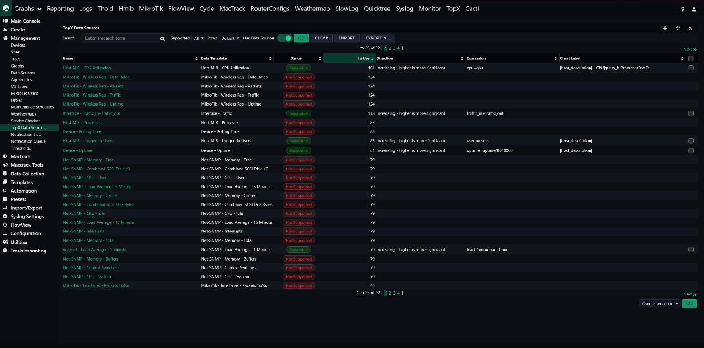
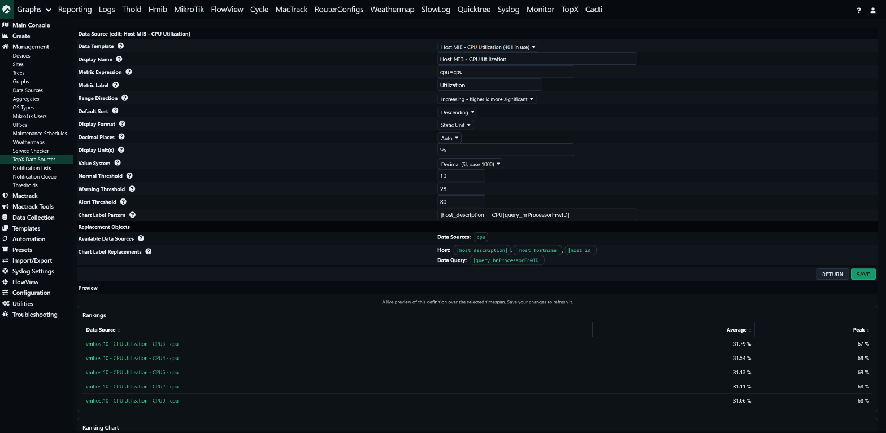

# Adding Your Own TopX Data Sources

As of TopX 1.2 you no longer edit any PHP files to add a Data Source. Everything
is managed from:

> **Console → Management → TopX Data Sources**

The list shows every Cacti Data Template, whether or not TopX already ranks it.
Use the filter bar (**Search**, **Supported: All / Yes / No**, **Has Data
Sources**, **Rows**) to narrow it down, exactly like Cacti's CDEF, Data Query and
other management pages. The **In Use** column shows how many Data Sources on your
devices use each template, so you can tell in-use templates from unused ones at a
glance.

Click a row (or the **+** / Add link) to open the editor, fill in the fields
below and save. Clicking a template whose **Status** shows *Not Supported* opens
the editor already pointed at that template, so turning it into a supported
source only takes a couple of clicks. Use **Import** / **Export All** to move
definitions between installs — the export is an XML document keyed on the Data
Template hash, so it applies cleanly to any Cacti that has the same template.

## One Data Source or several?

A Data Template often defines more than one RRD data source (for example an
interface template has `traffic_in` and `traffic_out`).

- **Just one of them** — create a single definition and name that field in the
  Metric Expression, e.g. `traffic_in=traffic_in`. You do *not* need multiple
  rows for this.
- **Several of a template's fields, ranked separately** (e.g. a Top-N of inbound
  traffic *and* a separate Top-N of outbound traffic) — add one definition per
  field; multiple rows for the same Data Template are allowed, and each becomes
  its own entry in the dashboard's data source picker.
- **A combination** (sum, percentage, …) — use one definition with a combining
  Metric Expression, e.g. `traffic_in+traffic_out` or `hdd_total%hdd_used`.

The bundled defaults are seeded against the standard Cacti package template
hashes. If your install uses a template with a different hash (a custom or
repackaged template), the seeded row shows as *(template not installed)* and your
real template shows as *Not Supported* — just click it and configure a
definition. Support is keyed on the exact template hash, which is why a template
may not appear "auto-supported".

## Editor fields

| Field | Description |
| --- | --- |
| **Data Template** | The Cacti Data Template this definition ranks. The portable template hash is stored, so the definition survives export/import between installs. |
| **Display Name** | Friendly name shown on the dashboards. Blank = template name. |
| **Metric Expression** | How the RRD data source fields are combined: single field `cpu=cpu`, sum `traffic_in+traffic_out`, percentage `hdd_total%hdd_used`, or scaled `uptime=uptime/8640000`. |
| **Metric Label** | Short label for what is measured (e.g. "Utilization", "Bits"); used on the chart value axis. |
| **Range Direction** | *Increasing* — higher is more significant (CPU, traffic); or *Decreasing* — lower is more significant (free disk space, uptime headroom). Drives the default ranking sense and the threshold colouring. |
| **Default Sort** | Default sort direction when the source is first opened. |
| **Display Format** | *Static Unit* rounds to the decimal places and appends a single unit; *Division by Unit Ladder* walks a slash-delimited unit/divisor ladder (e.g. bit/Kbit/Mbit). |
| **Decimal Places** | Number of decimals the displayed value is rounded to (*Auto* = two places). Applies to both Display Formats. |
| **Display Unit(s)** | The display unit for *Static Unit*, or a slash-delimited ladder of unit names for *Division by Unit Ladder* (e.g. `bit/Kbit/Mbit/Gbit`). |
| **Display Unit Ladder** | *(Division by Unit Ladder only)* The slash-delimited divisor ladder paired with the units above, smallest to largest (e.g. `1/1000/1000000`). |
| **Value System** | Numbering system used when auto-scaling unsupported values. |
| **Normal / Warning / Alert Threshold** | Optional absolute health thresholds. Leave all blank to disable threshold colouring and show a plain Peak/Average chart. For an *Increasing* range a value at or beyond a threshold is in that band; for a *Decreasing* range a value at or below it is. These are an absolute health signal, independent of the "Values by % of Peak" card. |
| **Chart Label Pattern** | How each ranked item is named on the chart, using `\|token\|` substitution (see [Chart Label tokens](#chart-label-tokens) below). Blank = derive the label from the Data Source name. |

### Chart Label tokens

The **Chart Label Pattern** names each ranked bar using `|token|` substitution:

- `|host_description|`, `|host_hostname|`, `|host_id|` — the device the data
  source belongs to.
- `|query_<field>|` — a Data Query field for the instance, e.g. `|query_ifName|`
  or `|query_hrStorageDescr|`.

For example, `|host_description| - |query_ifName|` renders as
`core-switch1 - GigabitEthernet0/1`. Unresolved tokens are dropped and the
separators tidied, so the pattern degrades cleanly.
