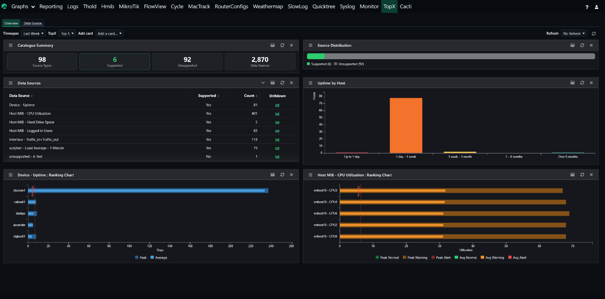
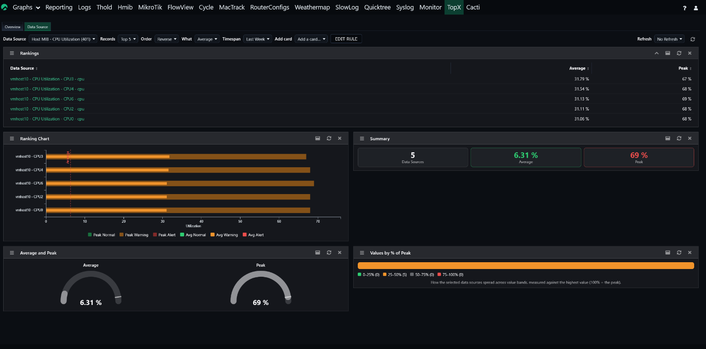

# plugin_topx for Cacti

## TopX

Displays the highest and lowest values across your data sources (for example the
most-utilized CPUs or the busiest interfaces), driven entirely by Cacti's native
dsstats rollup tables. Supported data source definitions can combine or scale
metrics (for example errors + discards, or traffic in + out converted to bits).

This release modernizes the plugin to current Cacti 1.2.32 standards: prepared
statements with allowlisted identifiers, request validation and output escaping,
a strongly typed, PHPDoc-documented `includes/` API, theme-neutral CSS, organized
JavaScript, full `gettext` internationalization, a shipped-file `manifest.json`
with upgrade-time pruning, and a Pest test suite. See [CHANGELOG.md](CHANGELOG.md)
for details.

## Requirements

- Cacti 1.2.32 or later
- DS Stats enabled and configured (Console → Settings → Data)

## Screenshots

The all-source **Overview** tab — a composable dashboard of catalogue stats,
an Uptime-by-Host chart and per-Data-Source ranking cards:

The per-source **Data Source** drilldown — rankings, a health-coloured ranking
chart, summary tiles, average/peak gauges and a value distribution:

## Installation

1. Copy the `topx` directory into Cacti's `plugins/` directory.
2. Ensure the files are readable by the web server user.
3. Enable the plugin (Console → Plugin Management).
4. Enable DS Stats if it is not already active.

## Upgrade

1. Copy the new files over the existing `plugins/topx` directory.
2. Ensure the files are readable by the web server user.
3. Load any Cacti console page; the plugin's upgrade hook refreshes its
   registration, re-applies its (idempotent) schema, and prunes files that are
   no longer shipped (recorded in `manifest.json`).

## Adding your own data sources

Use **Console → Management → TopX Data Sources**. From there you can see every
Data Template (configured or not), filter by **Supported: All / Yes / No**, and
add, edit, delete, import or export the definitions — no PHP editing required.
Each definition points at a Data Template by its portable hash, describes how its
RRD fields combine (the metric expression) and how values are scaled and named
on the charts. See [HOW_TO_ADD_YOUR_DATA.md](HOW_TO_ADD_YOUR_DATA.md) for a
field-by-field description of the `plugin_topx_source` definition.

## Possible bugs or ideas?

Please open an issue on GitHub, or post to
https://forums.cacti.net/viewtopic.php?f=5&t=56129

## Author

Originally written by Petr Macek (petr.macek@kostax.cz). Maintained by the
Cacti Group.

## Changelog

See [CHANGELOG.md](CHANGELOG.md).
